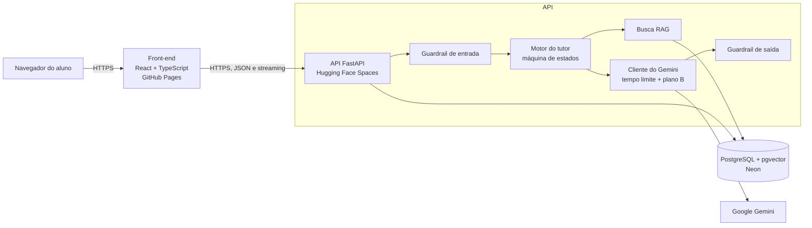
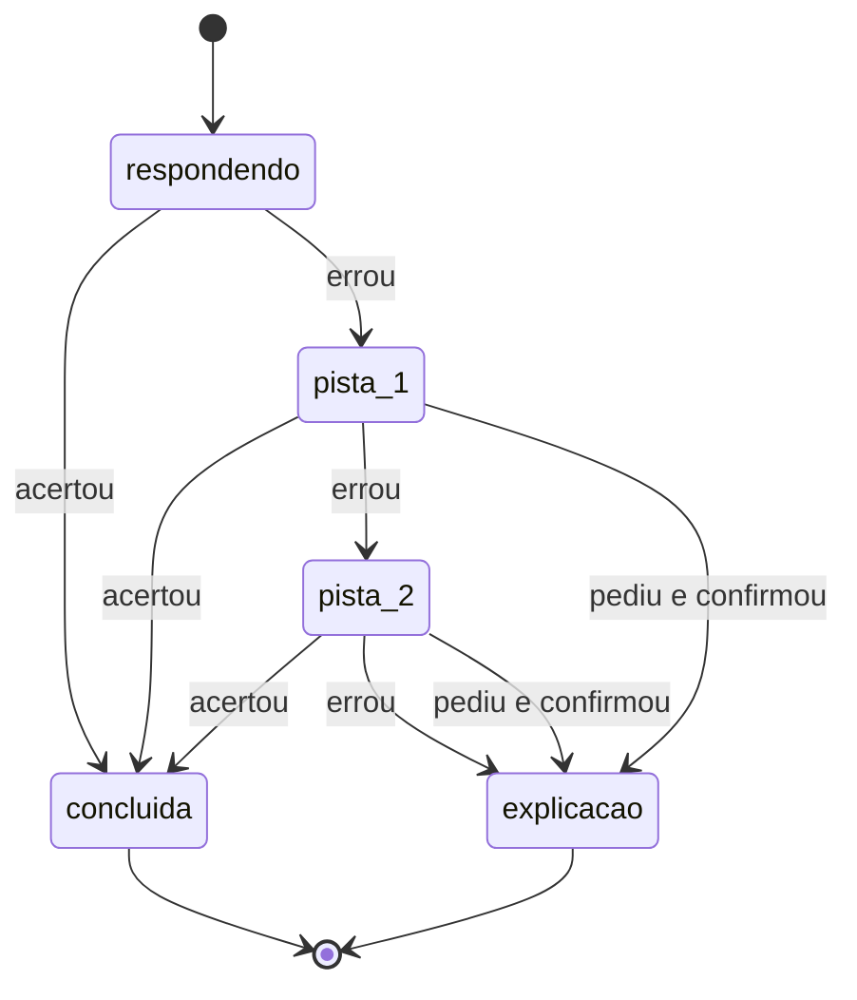
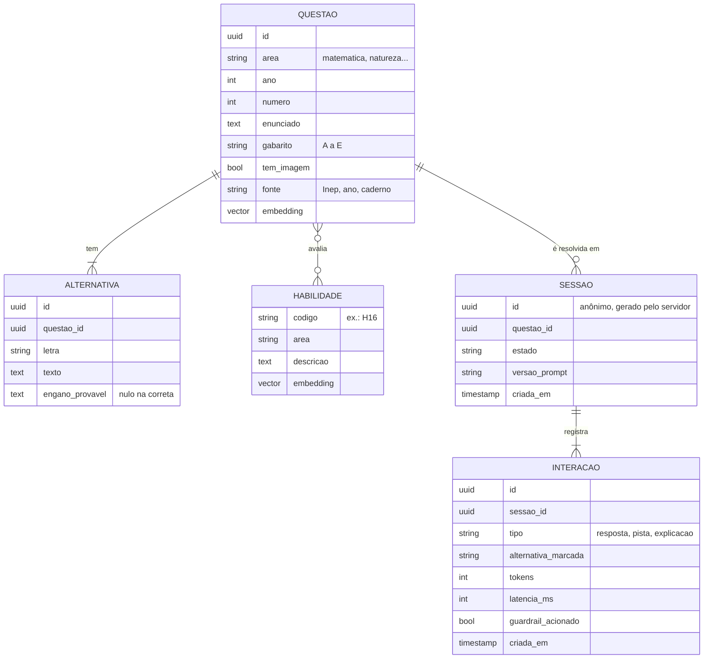

# Arquitetura

## Visão geral

| Componente | Responsabilidade |
|---|---|
| Front-end | Mostrar a questão, receber a alternativa, exibir a conversa em streaming. Não guarda nenhum segredo. |
| API | Validar entradas, controlar sessões, aplicar limites de uso e orquestrar o tutor. |
| Motor do tutor | Decidir o nível da pista e montar o contexto do prompt. **Quem decide se o aluno acertou é o código, comparando com o gabarito, e não a IA.** |
| Busca RAG | Encontrar as habilidades da matriz e as questões relacionadas para apoiar a pista. |
| Cliente do Gemini | Chamar o modelo com tempo limite e novas tentativas. Se falhar, devolver uma mensagem padrão. |
| Guardrail de entrada | Limitar o tamanho da mensagem e identificar tentativas de manipulação do prompt. |
| Guardrail de saída | Antes do nível 3, bloquear e refazer qualquer resposta que revele a alternativa correta. |
| Banco | Questões, alternativas, habilidades, vetores, sessões anônimas e interações. |

## Máquina de estados da sessão

Regras:
- A resposta correta só pode aparecer no estado `explicacao`.
- O aluno pode pedir a explicação a qualquer momento, mas precisa confirmar.
- Cada estado tem um prompt próprio, guardado em `prompts/`.

## Modelo de dados

- **Sem dados pessoais:** a sessão não tem nome, e-mail nem IP salvo.
- **Retenção:** interações são apagadas após 30 dias. Só ficam números agregados (taxa de acerto por questão, nível médio de pista).

## Rotas da API

| Método | Rota | O que faz |
|---|---|---|
| GET | `/health` | Verifica se a API está de pé, quantas questões carregou e se a IA está ativa |
| GET | `/questoes?area=&ano=` | Lista questões com filtros |
| GET | `/questoes/{id}` | Enunciado e alternativas, **sem o gabarito** |
| POST | `/sessoes` | Abre uma sessão anônima para uma questão |
| GET | `/sessoes/{id}` | Estado, tentativas e mensagens da sessão (para retomar depois de recarregar a página) |
| POST | `/sessoes/{id}/respostas` | Envia a alternativa marcada e devolve o próximo estado e a mensagem do tutor |
| POST | `/sessoes/{id}/mensagens` | Conversa com o tutor em streaming (Server-Sent Events: eventos `trecho` e `fim`) |
| POST | `/sessoes/{id}/explicacao` | Pede a explicação completa (exige `confirmar: true` e pelo menos uma tentativa) |
| GET | `/questoes/{id}/parecidas` | Sugere questões para praticar (RAG, Fase 7) |

- O gabarito nunca sai da API antes de a resposta ser revelada (`explicacao` ou `concluida`), nem mesmo dentro do JSON.
- Erros sempre vêm como `{"erro": {"codigo": "...", "mensagem": "..."}}`: 404 para questão ou sessão inexistente, 409 para ação não permitida no estado atual (por exemplo, `alternativa_repetida`), 422 para dados inválidos e 500 sem detalhes internos.
- Campos desconhecidos no corpo são recusados (422).
- Até a Fase 5, as sessões ficam em memória, expiram em 24 horas e são limitadas a 10 000. Cada sessão tem um lock, para que duas requisições simultâneas não mudem o estado dela em paralelo.
- A documentação interativa (Swagger) fica em `/docs`.

## Front-end

- **Telas:** página inicial (o que é o Pista e a lista de questões por ano) e página da questão (enunciado, alternativas, nível da pista, última mensagem do tutor em destaque, conversa e explicação com confirmação).
- **Rotas por hash** (`#/questao/2022-141`): funcionam no GitHub Pages sem configuração extra no servidor.
- **Fórmulas e tabelas:** Markdown com `remark-math` e KaTeX. O cifrão de dinheiro vem escapado (`R\$`) para não virar fórmula.
- **Streaming:** a conversa usa `fetch` com leitura do corpo em Server-Sent Events, porque o `EventSource` do navegador só faz GET.
- **Sessão retomada:** o identificador da sessão fica no `sessionStorage` da aba. Ao recarregar a página, a conversa continua de onde parou.
- **Carregamento sob demanda:** a página da questão (com KaTeX e Markdown) só é baixada quando o aluno abre uma questão. A página inicial fica com cerca de 75 kB comprimidos.
- **Estados de erro:** sem conexão, questão inexistente e falha numa ação têm mensagem própria e botão para tentar de novo. Quando a IA está desativada, aparece o aviso de "modo básico".

## Prompts e guardrails

- **Prompts versionados:** `prompts/tutor_v1.md`, `prompts/tutor_v2.md` e assim por diante. Cada interação guarda a versão usada, e a avaliação compara versões antes de trocar.
- **Contexto mínimo:** o modelo recebe o enunciado, as alternativas, as alternativas já marcadas com o engano provável de cada uma e a habilidade da matriz. O gabarito e a resolução revisada vão junto para que a pista seja correta, e por isso existe o guardrail de saída.
- **Guardrail de saída:** procura a letra da alternativa correta ("alternativa C", "(C)") e o conteúdo dela (o valor ou o texto, inclusive com outra formatação, como "960" para "R\$ 960,00") na resposta. Valores que já aparecem no enunciado não contam. Se encontrar antes da explicação, pede outra resposta com um reforço na instrução. Se vazar duas vezes, envia uma pista escrita à mão; na pista 2, ela usa o engano anotado da alternativa marcada.
- **Verificar antes de enviar:** com a resposta protegida, a mensagem da IA é gerada inteira, verificada e só depois enviada em trechos. Não dá para fazer streaming direto e verificar ao mesmo tempo. Depois que a resposta é revelada, o streaming vem direto da IA.
- **Plano B:** se a IA falhar (ou não houver chave configurada), o tutor continua funcionando com mensagens escritas à mão e com a resolução revisada da questão na explicação.
- **Pedidos da resposta** ("qual é a letra certa?") são respondidos com uma mensagem fixa, sem chamar a IA.
- **Guardrail de entrada:** mensagens acima de 1.000 caracteres são recusadas. Padrões de manipulação ("ignore as instruções", "você agora é...") são registrados e respondidos com uma mensagem padrão.

## Decisões técnicas

| Decisão | Alternativas consideradas | Motivo |
|---|---|---|
| **Google Gemini** como modelo | OpenAI, Claude, modelos abertos | Plano gratuito, bom em português e já usado no CO2Bank. Principal: `gemini-3.8-flash` com raciocínio `low`, para responder rápido. Reserva: `gemini-3.5-flash-lite`. Os dois são configuráveis por variável de ambiente, e o cliente fica isolado em `api/app/tutor/ia.py` para facilitar a troca. |
| **FastAPI** na API | Flask | Validação com Pydantic nativa, streaming e documentação automática. Já uso Pydantic no CO2Bank. |
| **PostgreSQL + pgvector** | Banco vetorial dedicado (Pinecone, Chroma) | Um banco só para dados e vetores. O volume de questões é pequeno, e o pgvector dá conta. |
| **Neon** como banco | Supabase, Render | PostgreSQL gerenciado com pgvector em plano gratuito. |
| **Hugging Face Spaces** na API | Render | Meus outros projetos já usam as horas gratuitas do Render. Além disso, o Spaces é a vitrine padrão de projetos de IA. |
| **GitHub Pages** no front-end | Vercel, Netlify | Já uso no portfólio e no CO2Bank, e o deploy fica no mesmo GitHub Actions. |
| **Verificação da resposta no código** | Deixar a IA julgar | Gabarito é dado, não opinião. A IA só cuida da conversa. |
| **Sem login** | Cadastro com e-mail | Muitos alunos são menores de idade. Sem dados pessoais, o risco de privacidade cai muito. |

Os limites dos planos gratuitos mudam com frequência. Eles são conferidos na Fase 0 e revistos a cada release.
