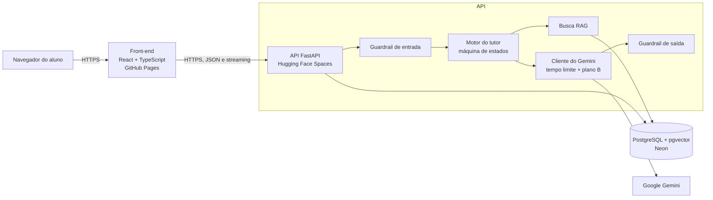
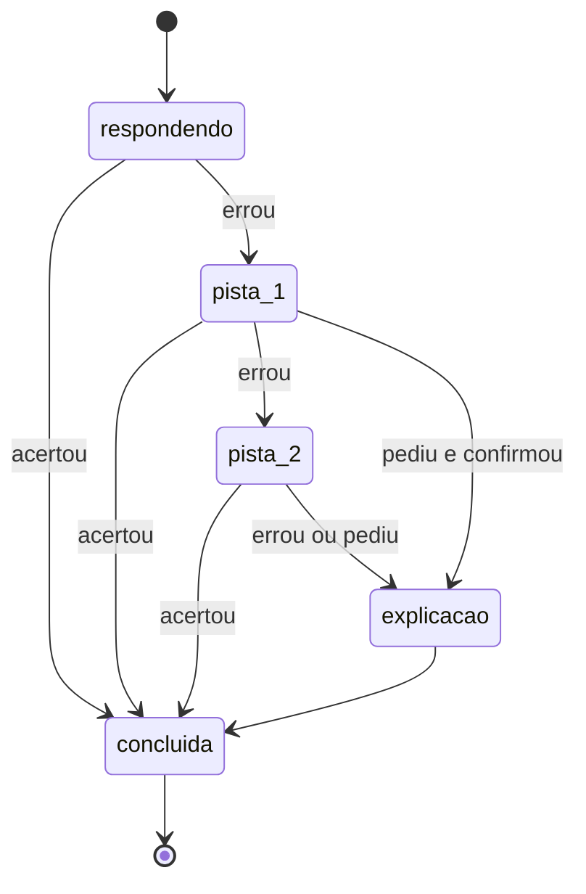
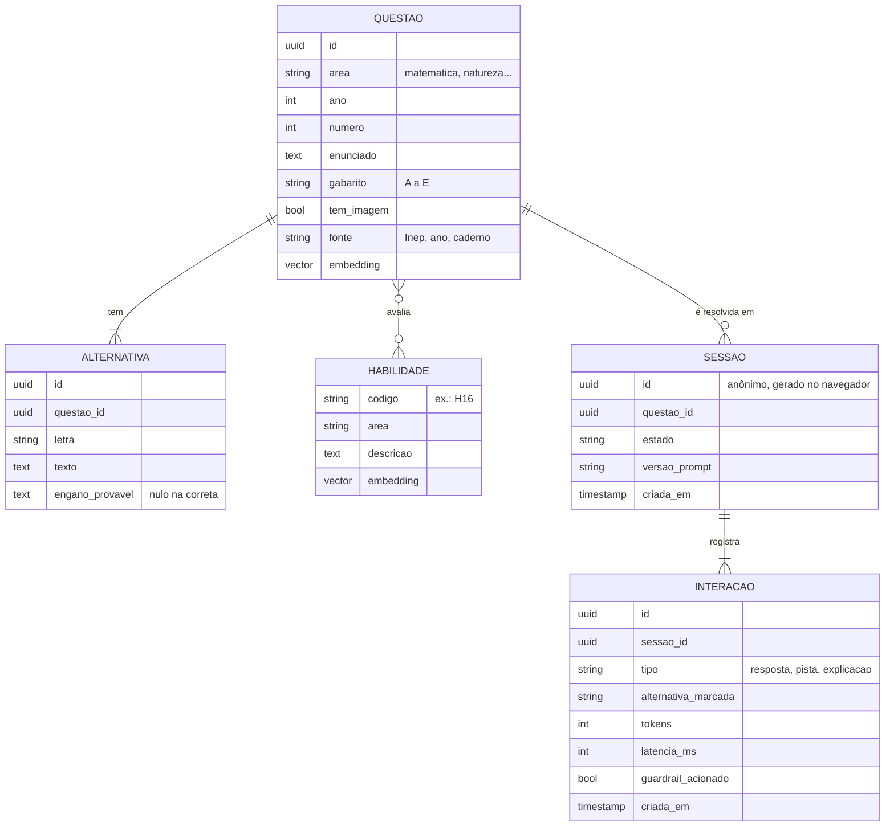

# Arquitetura

## Visão geral

| Componente | Responsabilidade |
|---|---|
| Front-end | Mostrar a questão, receber a alternativa, exibir a conversa em streaming. Não guarda nenhum segredo. |
| API | Validar entradas, controlar sessões, aplicar limites de uso e orquestrar o tutor. |
| Motor do tutor | Decidir o nível da pista e montar o contexto do prompt. **Quem decide se o aluno acertou é o código, comparando com o gabarito, e não a IA.** |
| Busca RAG | Encontrar as habilidades da matriz e as questões relacionadas para apoiar a pista. |
| Cliente do Gemini | Chamar o modelo com tempo limite e novas tentativas. Se falhar, devolver uma mensagem padrão. |
| Guardrail de entrada | Limitar o tamanho da mensagem e identificar tentativas de manipulação do prompt. |
| Guardrail de saída | Antes do nível 3, bloquear e refazer qualquer resposta que revele a alternativa correta. |
| Banco | Questões, alternativas, habilidades, vetores, sessões anônimas e interações. |

## Máquina de estados da sessão

Regras:
- A resposta correta só pode aparecer no estado `explicacao`.
- O aluno pode pedir a explicação a qualquer momento, mas precisa confirmar.
- Cada estado tem um prompt próprio, guardado em `prompts/`.

## Modelo de dados

- **Sem dados pessoais:** a sessão não tem nome, e-mail nem IP salvo.
- **Retenção:** interações são apagadas após 30 dias. Só ficam números agregados (taxa de acerto por questão, nível médio de pista).

## Rotas da API

| Método | Rota | O que faz |
|---|---|---|
| GET | `/health` | Verifica se a API e o banco estão de pé |
| GET | `/questoes?area=&ano=` | Lista questões com filtros |
| GET | `/questoes/{id}` | Enunciado e alternativas, **sem o gabarito** |
| POST | `/sessoes` | Abre uma sessão anônima para uma questão |
| POST | `/sessoes/{id}/respostas` | Envia a alternativa marcada e devolve o próximo estado |
| POST | `/sessoes/{id}/mensagens` | Conversa com o tutor (streaming) |
| POST | `/sessoes/{id}/explicacao` | Pede a explicação completa (exige confirmação) |
| GET | `/questoes/{id}/parecidas` | Sugere questões para praticar (RAG) |

O gabarito nunca sai da API antes do estado `explicacao`, nem mesmo dentro do JSON.

## Prompts e guardrails

- **Prompts versionados:** `prompts/tutor_v1.md`, `prompts/tutor_v2.md` e assim por diante. Cada interação guarda a versão usada, e a avaliação compara versões antes de trocar.
- **Contexto mínimo:** o modelo recebe o enunciado, a alternativa marcada, o engano provável e as habilidades relacionadas. O gabarito vai junto para que a pista seja correta, e por isso existe o guardrail de saída.
- **Guardrail de saída:** procura a letra e o texto da alternativa correta (e variações) na resposta. Se encontrar antes do nível 3, gera outra resposta. Se falhar duas vezes, envia uma pista padrão escrita à mão para aquela questão.
- **Guardrail de entrada:** mensagens acima de 1.000 caracteres são recusadas. Padrões de manipulação ("ignore as instruções", "você agora é...") são registrados e respondidos com uma mensagem padrão.

## Decisões técnicas

| Decisão | Alternativas consideradas | Motivo |
|---|---|---|
| **Google Gemini** como modelo | OpenAI, Claude, modelos abertos | Plano gratuito, bom em português e já usado no CO2Bank. O cliente fica isolado num módulo para facilitar a troca. |
| **FastAPI** na API | Flask | Validação com Pydantic nativa, streaming e documentação automática. Já uso Pydantic no CO2Bank. |
| **PostgreSQL + pgvector** | Banco vetorial dedicado (Pinecone, Chroma) | Um banco só para dados e vetores. O volume de questões é pequeno, e o pgvector dá conta. |
| **Neon** como banco | Supabase, Render | PostgreSQL gerenciado com pgvector em plano gratuito. |
| **Hugging Face Spaces** na API | Render | Meus outros projetos já usam as horas gratuitas do Render. Além disso, o Spaces é a vitrine padrão de projetos de IA. |
| **GitHub Pages** no front-end | Vercel, Netlify | Já uso no portfólio e no CO2Bank, e o deploy fica no mesmo GitHub Actions. |
| **Verificação da resposta no código** | Deixar a IA julgar | Gabarito é dado, não opinião. A IA só cuida da conversa. |
| **Sem login** | Cadastro com e-mail | Muitos alunos são menores de idade. Sem dados pessoais, o risco de privacidade cai muito. |

Os limites dos planos gratuitos mudam com frequência. Eles são conferidos na Fase 0 e revistos a cada release.
