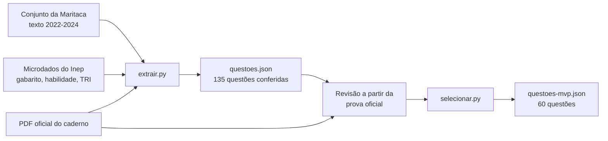

# Dados

De onde vêm as questões do Pista, como elas foram conferidas e em que condições são usadas.

## Fontes

| Fonte | O que fornece | Licença ou condição de uso |
|---|---|---|
| [Provas e gabaritos do Enem](https://www.gov.br/inep/pt-br/areas-de-atuacao/avaliacao-e-exames-educacionais/enem/provas-e-gabaritos) (Inep) | Cadernos oficiais em PDF, usados para conferir e transcrever cada questão | Publicação oficial e pública do Inep. Ver "Termos de uso" abaixo. |
| [Microdados do Enem](https://www.gov.br/inep/pt-br/acesso-a-informacao/dados-abertos/microdados/enem) (Inep) | Tabela `ITENS_PROVA`: gabarito oficial, habilidade da matriz, dificuldade (parâmetro b da TRI) e itens anulados | Dados abertos do Inep, com citação da fonte |
| [Matriz de referência do Enem](https://download.inep.gov.br/enem/outros_documentos/enem_matriz_de_referencia_v1.pdf) (Inep) | 7 competências e 30 habilidades de Matemática | Publicação oficial e pública do Inep |
| [maritaca-ai/enem](https://huggingface.co/datasets/maritaca-ai/enem) (Hugging Face) | Texto das questões de 2022 a 2024 em JSON, usado como ponto de partida | Apache-2.0. Referências: Pires et al. (2023), [arXiv:2311.14169](https://arxiv.org/abs/2311.14169), e Nunes et al. (2023), [arXiv:2303.17003](https://arxiv.org/abs/2303.17003) |

## Termos de uso

Pesquisa feita em novembro de 2026. **Isto não é um parecer jurídico.**

- O Inep publica as provas e os gabaritos de forma aberta no portal gov.br. Não encontrei um termo de uso específico para os cadernos de questões.
- O conteúdo publicado pelo Inep traz a regra geral "a reprodução é gratuita desde que citada a fonte".
- Decisões da Comissão Mista de Reavaliação de Informações sobre pedidos de acesso à informação mostram que o Inep restringe por até 5 anos algumas informações sobre os itens, para poder reutilizá-los. Isso não vale para as provas aplicadas: numa dessas decisões ([168/2025](https://www.gov.br/casacivil/pt-br/assuntos/colegiados/comissao-mista-de-reavaliacao-de-informacoes-cmri/decisoes-de-recurso-de-4a-instancia/2025/decisao-168-2025-nup-23546-071146-2023-72.pdf)), o Inep afirma que publica as provas de forma pública e coletiva.
- Algumas questões citam textos de terceiros. Nas de Matemática do MVP isso é raro, e a fonte original é mantida quando aparece no enunciado.

**Como o projeto usa os dados:**

1. Uso educacional e gratuito, sem fins comerciais.
2. Toda questão exibida mostra a fonte: Inep, ano, caderno e número da questão.
3. Os PDFs oficiais não são redistribuídos. O repositório só tem os scripts que os baixam do site do Inep.
4. O texto derivado do conjunto da Maritaca mantém a atribuição exigida pela licença Apache-2.0.
5. Se o Inep pedir, o conteúdo sai do ar.

## Como os dados foram montados



1. **Download** (`baixar.py`). A revisão do conjunto da Maritaca fica fixa. Dos microdados (zips de cerca de 500 MB), só a tabela de itens é baixada, lendo o zip por partes.
2. **Caderno certo.** O Enem tem várias cores de caderno, cada uma com as questões em outra ordem. O caderno que corresponde ao conjunto foi identificado comparando gabaritos e textos: **cinza em 2022, rosa em 2023 e verde em 2024**.
3. **Conferência automática** (`extrair.py`). Cada questão recebe o gabarito, a habilidade e a dificuldade dos microdados, e o texto é comparado com o PDF oficial.
4. **Revisão a partir da prova oficial.** Todas as questões candidatas foram transcritas de novo olhando a página oficial, com fórmulas em LaTeX. Na mesma revisão, cada questão foi resolvida sem acesso ao gabarito, e o engano provável de cada alternativa errada foi anotado.
5. **Seleção** (`selecionar.py`). Entram no MVP só as questões em que a resolução chegou ao gabarito oficial e a transcrição bate com o PDF. A escolha alterna entre habilidades para cobrir o máximo da matriz.

O resultado, com as questões escolhidas, as excluídas e o motivo de cada exclusão, está em [data/RELATORIO.md](../data/RELATORIO.md).

## Problemas encontrados no conjunto da Maritaca

| Problema | Exemplo | Como foi tratado |
|---|---|---|
| Em algumas posições, o texto é da **questão substituta do caderno adaptado** (ampliado ou leitor de tela), não da prova regular. O gabarito é o mesmo, mas a questão é outra, e a habilidade dos microdados não vale para ela. | 2022-152, 2023-146, 2024-178 | Detectado pela semelhança baixa com o PDF regular (12% a 25%). Essas questões ficaram de fora. |
| Fórmulas escritas por extenso, como no caderno para leitor de tela | "fração, numerador 7 fatorial, denominador..." | Transcrição nova em LaTeX |
| Números romanos trocados por algarismos | Alternativas "1, 2, 3" quando o quadro lista os operários I, II, III | Transcrição nova a partir da prova |
| Valores e símbolos reescritos | "R$ 2,00 menor" virou "2 reais menor"; "75%" virou "75 por cento" | Transcrição nova a partir da prova |
| Tabelas quebradas ou duplicadas | Colunas "nan" e "Unnamed: 2" em 2024-151; alternativas repetidas como tabela dentro do enunciado em 2022-144 | Tabela refeita em Markdown a partir da prova |
| Formatação de números e unidades perdida | "2500000" no lugar de "2 500 000"; "centímetros" no lugar de "cm"; subscritos de $T_1$ a $T_5$ perdidos | Transcrição nova a partir da prova |
| Linhas de fonte omitidas | Referência bibliográfica no fim do enunciado em 2023-153 e 2024-136 | Incluídas na transcrição |

**Conferência do gabarito.** Cada questão revisada foi resolvida sem acesso ao gabarito. Em 73 das 74, a resolução chegou ao gabarito oficial. A exceção foi a 2022-169, cujo enunciado o revisor já tinha marcado como ambíguo: ela ficou de fora do MVP.

## Formato de `questoes-mvp.json`

```json
{
  "id": "2022-140",
  "ano": 2022,
  "numero": 140,
  "area": "matematica",
  "enunciado": "Markdown, com fórmulas em LaTeX entre $...$",
  "alternativas": [
    { "letra": "A", "texto": "I.", "engano_provavel": "Escolheu o menor preço por hora sem considerar o tempo total." }
  ],
  "gabarito": "E",
  "resolucao": "Passo a passo, um passo por linha",
  "habilidade": { "codigo": "H3", "descricao": "Resolver situação-problema envolvendo conhecimentos numéricos." },
  "competencia": { "codigo": "C1", "descricao": "..." },
  "conceitos": ["operações com números racionais"],
  "dificuldade_tri": 0.85,
  "fonte": {
    "orgao": "Inep",
    "prova": "ENEM 2022, 2º dia, caderno 6 (cinza), questão 140",
    "url": "https://download.inep.gov.br/enem/provas_e_gabaritos/2022_PV_impresso_D2_CD6.pdf",
    "item_inep": "12345"
  }
}
```

- `engano_provavel` é `null` na alternativa correta.
- `dificuldade_tri` é o parâmetro b da TRI: quanto maior, mais difícil. Fica `null` quando o item saiu da calibração da TRI por motivo estatístico (`fora_da_tri` em `questoes.json`).
- O exemplo acima é ilustrativo. Os valores reais estão no arquivo.

## Limitações

- **2025 ainda não entrou.** O conjunto da Maritaca vai até 2024, e extrair Matemática direto do PDF estraga as fórmulas. As questões de 2025 entram na Fase 7, transcritas da prova oficial do mesmo jeito.
- **Só questões sem figura.** Questões com gráfico ou figura geométrica entram na Fase 10.
- **Os enganos prováveis são hipóteses.** Foram deduzidos pela conta que leva a cada alternativa, e não por dados de alunos. Os microdados têm as respostas dos participantes, então dá para medir qual alternativa errada é mais marcada (evolução possível).
